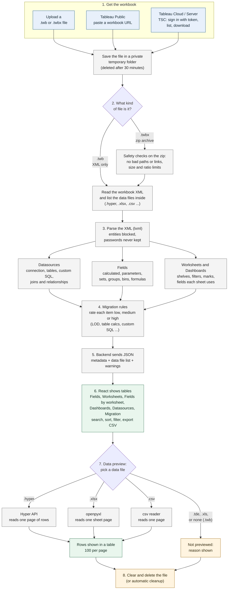

# Tableau Workbook Reader

A web app that opens a Tableau workbook (`.twbx` or `.twb`) and shows what is inside it in sortable, filterable tables:

- **Metadata:** datasources (with join and relationship details and custom SQL), fields, calculated-field formulas, parameters, sets, groups, bins, worksheets (shelves, filters, mark types) and dashboards.
- **Row data:** the rows in a packaged workbook's bundled extract (`.hyper`), Excel (`.xlsx`) or CSV files.
- **Migration hints:** a rule-based effort rating (low, medium, high) for each field, datasource and worksheet calculation, flagging constructs that need rewriting in Power BI or Looker.

Every table exports to CSV. **Stack:** React + Vite, Python FastAPI, `lxml`, [Tableau Server Client](https://tableau.github.io/server-client-python/) (TSC), and the Tableau Hyper API.

## Tableau Public vs Tableau Cloud, and what TSC does here

TSC is a client for the Tableau **Server / Cloud REST API**. It signs in with a personal access token (PAT), lists workbooks and downloads them. It does **not** read what is inside a workbook. A `.twbx` is a zip containing XML (`.twb`) plus data files, so a separate parser (`lxml`) reads it.

Tableau Public does not offer the Server REST API, so TSC cannot be used with it. That is why there are three sources:

| Source | What it needs | Status |
|---|---|---|
| **Upload** | A `.twb` or `.twbx` file | Tested, including with real Tableau sample workbooks. |
| **Tableau Public** | A public workbook URL | Works (checked by hand). |
| **Tableau Server / Cloud (TSC)** | Server URL, site name and a personal access token | Works on Tableau Cloud (checked by hand). |

Details on how each source was checked:

- **Upload:** covered by automated tests and by runs on real sample workbooks.
- **Tableau Public:** pasting a workbook URL was confirmed in a manual test with a real public workbook. Tableau does not document the download address this source uses, so it could change. It is configurable (see Configuration), and if a download fails, use Upload. There is no automated test against the live site.
- **Tableau Server / Cloud:** listing workbooks and selecting one was confirmed in a manual test against Tableau Cloud. Self-hosted Tableau Server uses the same code but has not been tried. The automated tests use a fake TSC module, TSC's own classes, and an in-process fake of the REST API, so there is no automated test against a live site.

The UI tags a source "untested" if it has not been confirmed against a live service. A `.twb` file is XML only and never contains data, so row preview needs a `.twbx`.

## Quick start

Requirements: Python 3.11 or newer and Node 20 or newer (CI uses 22), **or** Docker.

**With Docker** (one command; the image build has not been run by the author, see [Testing](#testing)):

```bash
docker compose up --build        # then open http://localhost:8000
```

Compose reads `backend/.env` if it exists (see below), so Server/Cloud settings work the same way.

**Without Docker:**

```bash
# Backend
cd backend
python -m venv .venv && source .venv/bin/activate      # Windows: .venv\Scripts\activate
pip install -r requirements.txt                        # or requirements.lock for exact tested versions (Linux/macOS)
pip install -r requirements-hyper.txt                  # optional: .hyper row previews
cp .env.example .env                                   # optional: only needed for Server/Cloud
python -m uvicorn app.main:create_app --factory --port 8000

# Frontend (second terminal)
cd frontend
npm install
npm run dev                                            # http://localhost:5173, proxies /api to port 8000
```

To serve everything from one port, run `npm run build` in `frontend`; the backend then serves `frontend/dist` at http://localhost:8000 (set `FRONTEND_DIST` to use another folder).

Without the Hyper API, everything works except `.hyper` row previews, and the UI says so. On a Mac the newest `tableauhyperapi` releases have no wheel, so pip picks an older one; do not pin it.

### Connecting Tableau Server or Cloud

1. In Tableau, create a personal access token (My Account Settings, then Personal Access Tokens).
2. Put these in `backend/.env`: `TABLEAU_SERVER_URL` (for example `https://10ax.online.tableau.com`, no path), `TABLEAU_SITE` (the name after `/site/` in your browser address), `TABLEAU_PAT_NAME` and `TABLEAU_PAT_SECRET`.
3. Restart the backend. The token stays on the backend and is never sent to the browser.

A token allows one session at a time, so the backend serialises its Server requests. One slow download can briefly delay another Server request.

## Using the app

1. Choose a source on the left: **Tableau Public** (paste a workbook URL and click **Parse workbook**), **Server or Cloud** (click **List workbooks**, then **Parse**), or **Upload a file**.
2. The workbook opens on the right. Warnings at the top explain things like live connections or published datasources.
3. Use the tabs: **Fields**, **Worksheets**, **Fields by worksheet**, **Dashboards**, **Datasources**, **Migration** and **Data preview**. Each table can be searched, sorted, filtered by type and exported to CSV with **Export CSV**.
4. Click **Clear and delete the file** when done. The backend also deletes it automatically after `SESSION_TTL_MINUTES`.

## How it works

From a workbook file to the tables on screen:



Image version: [docs/flowchart.png](docs/flowchart.png).

## Design decisions

- **TSC only moves files.** Parsing is done by `lxml`, so Upload, Public and Server all go through the same parser.
- **`lxml` instead of Tableau's Document API.** The Document API is labelled unsupported by Tableau and covers only connections and fields. The parser reads worksheets, dashboards, joins and formulas too.
- **Upload is the primary path.** It is the only source that does not depend on unofficial URLs or a Tableau account.
- **Honest status.** Each source reports whether it has been verified, and the UI shows it.
- **Untrusted input.** Workbooks and URLs are treated as hostile (see Security).

## Migration hints

The **Migration** tab and the "Migration effort" column on the Fields tab estimate how hard each item would be to rebuild in another BI tool.

| Effort | What triggers it |
|---|---|
| High | LOD expressions (`{FIXED ...}`), table calculations in formulas (`WINDOW_*`, `RUNNING_*`, `LOOKUP`, `INDEX`, `RANK`...), **quick table calculations set on a worksheet shelf** (percent of total, running total...), `SCRIPT_*` (R/Python), `RAWSQL_*`, user-based security (`USERNAME()`, `ISMEMBEROF()`), custom SQL |
| Medium | Parameters, spatial functions, `ATTR()`, regular expressions, published datasources |
| Low | Simple calculated fields, aggregations, date functions, sets, groups, bins, extracts, joins and relationships |

Formulas are cleaned first, so keywords inside string literals, comments and field names do not trigger a rule. The overall rating follows a simple rule with no weights: **high** with 3 or more high items, **medium** with 1 or 2 high items or 5 or more medium items, otherwise **low**. These are keyword rules, not a formula parser; they can miss unusual constructs, cannot judge business logic, and have not been compared with real migration effort. Use them to plan a human review; they do not convert formulas.

## Configuration

All settings are environment variables, read from `backend/.env` or the process environment. See `backend/.env.example`.

| Variable | Default | Purpose |
|---|---|---|
| `TABLEAU_SERVER_URL`, `TABLEAU_SITE`, `TABLEAU_PAT_NAME`, `TABLEAU_PAT_SECRET` | none | Enable the Server/Cloud source. |
| `MAX_FILE_MB` | 500 | Largest workbook accepted. |
| `MAX_UNCOMPRESSED_MB` | 2048 | Largest total size of a `.twbx` after unzipping. |
| `MAX_ARCHIVE_MEMBERS` | 5000 | Most files allowed inside a `.twbx`. |
| `MAX_COMPRESSION_RATIO` | 200 | Zip-bomb guard. |
| `MAX_TWB_MB` | 100 | Largest workbook XML. |
| `HTTP_TIMEOUT_SECONDS` | 60 | Timeout for downloads. |
| `SESSION_TTL_MINUTES` | 30 | How long a loaded workbook stays on the backend. |
| `MAX_SESSIONS` | 20 | Most workbooks held at once. |
| `DEFAULT_PREVIEW_ROWS` / `MAX_PREVIEW_ROWS` | 100 / 1000 | Row preview page size. |
| `PUBLIC_ALLOWED_HOSTS` | `public.tableau.com` | Hosts the Public source may contact. |
| `PUBLIC_DOWNLOAD_URL_TEMPLATE` | built in | Override the unofficial Public download address without changing code. |
| `CORS_ORIGINS` | localhost:5173 | Allowed browser origins. |

## API

| Method and path | Purpose |
|---|---|
| `GET /api/health` | Liveness check. |
| `GET /api/capabilities` | Which sources are available, limits, and whether Hyper preview is installed. |
| `GET /api/sources/server/workbooks?q=` | List workbooks on the configured Tableau Server or Cloud site. |
| `POST /api/workbooks/parse` | Body `{source, reference}`. Download and parse a workbook. |
| `POST /api/workbooks/upload` | Multipart `file`. Parse an uploaded workbook. |
| `GET /api/workbooks/{id}/preview/tables?file=` | Tables in a bundled data file. |
| `GET /api/workbooks/{id}/preview/rows?file=&table=&offset=&limit=` | One page of rows. |
| `DELETE /api/workbooks/{id}` | Delete the workbook from the backend now. |

Errors use the shape `{"detail": {"code": "...", "message": "..."}}`. FastAPI also serves interactive docs at `/docs`.

## Security notes

This app reads files and URLs a user supplies, so it treats them as hostile.

- **Zip handling:** archives are never extracted wholesale. Names are validated (no absolute paths, `..`, or symlinks), and member count, total size and compression ratio are capped. Excel files, which are zips too, get the same checks.
- **XML:** parsed with entity resolution, DTD loading and network access off; documents containing `<!ENTITY` are rejected.
- **SSRF (Public source):** HTTPS only, hosts restricted to `PUBLIC_ALLOWED_HOSTS`, the download URL is rebuilt from a name extracted from the input, redirects are followed manually and re-checked, and size and time are capped.
- **Credentials:** workbooks often embed usernames and passwords in connection elements. The parser never outputs them. Tests plant fake secrets and assert they never appear in any response.
- **PAT:** stays on the backend. Error messages never include it.
- **SQL:** Hyper table names are checked against the file's catalog and never interpolated into queries.
- **CSV export:** cells starting with `=`, `+`, `-` or `@` are prefixed so spreadsheets don't run them as formulas.
- **Retention:** workbooks live in private temp folders, are deleted after `SESSION_TTL_MINUTES`, on error, when you click "Clear and delete the file", and on shutdown.
- **No authentication:** there is no login. Run it locally or behind your own access control. Moving this to a team setting needs single sign-on, per-user Tableau access, TLS, secrets management, audit logging and controls on row preview. The full roadmap is in [SPEC.md](SPEC.md).

## Troubleshooting

| Message or symptom | Cause and fix |
|---|---|
| `ModuleNotFoundError: No module named 'fastapi'` | The virtual environment is not active, or `pip install` was skipped. Run `source .venv/bin/activate`, then `pip install -r requirements.txt`, and start with `python -m uvicorn ...`. |
| "Cannot reach the backend" in the page | The backend is not running. Start it (step above). |
| `GET / 404 Not Found` in the backend log | You opened port 8000 without building the frontend. Use http://localhost:5173 with `npm run dev`, or run `npm run build` first. |
| Server or Cloud tab says it isn't set up | `backend/.env` is missing or incomplete. Copy `.env.example` to `.env`, fill in the four `TABLEAU_` values, and restart the backend. |
| Sign-in fails on Cloud | Check the site name (case-sensitive, from `/site/` in the address bar), that the URL has no path, and that the token is not used by another session. |
| Data preview says rows can't be previewed | The file is a `.twb` (no data inside), the workbook has only live connections, the extract is a legacy `.tde`, or the Hyper API is not installed. |
| Public download fails | The unofficial Public URLs may have changed or the author disabled downloads. Use Upload instead. |

## Known limitations

- Tableau Cloud and Tableau Public were each confirmed by hand only, with no automated test against the live services. Tableau Public relies on an unofficial download address. Self-hosted Tableau Server has not been tried.
- **Published datasources:** a workbook using one only records the fields it references. The full field list is on the server. The app shows a warning and the datasource's location.
- **Live connections:** the workbook holds the query, not the data. Custom SQL is shown; rows are not. Fetching the data a view shows through TSC would close this gap but needs a real site to build safely.
- **Row preview** supports `.hyper` (needs the Hyper API), `.xlsx`/`.xlsm` and CSV-like files. Legacy `.tde` and `.xls` files are listed but not previewed.
- **Roles** (dimension or measure) are sometimes not stored in a workbook, so the app infers them from the data type and marks them with `*`.
- Tableau's workbook XML is undocumented and changes between versions. Unknown structures produce warnings instead of failures where possible.
- Server downloads have no size cap in TSC; the cap is checked after the download.
- Frontend lint is not set up; backend lint (`ruff`) runs in CI.

## Testing

```bash
cd backend && pip install -r requirements-dev.txt -r requirements-hyper.txt && ruff check . && python -m pytest tests -q
cd frontend && npm test && npm run build
```

Backend: 240 tests, 1 skipped on purpose. The skipped one runs the parser over your own workbooks and needs a folder: `TWB_SAMPLES_DIR=/path/to/workbooks python -m pytest tests -q`. Hyper tests skip if the Hyper API is not installed.

The tests that say the most:

| Area | File |
|---|---|
| Parser on workbook structures, formulas, credentials never leaking | `tests/test_parser.py` |
| Zip and XML safety | `tests/test_archive.py` |
| TSC flow: errors, paging, one session at a time, fake REST server | `tests/test_sources_server.py`, `tests/test_server_rest_fake.py` |
| API happy paths and failures, CSV and Excel previews | `tests/test_api.py`, `tests/test_preview.py` |
| Migration rules, joins, quick table calcs | `tests/test_migration.py`, `tests/test_joins_and_tablecalcs.py` |

What was done by hand and is **not** in the repo: mutation checks (deliberately breaking a security or parsing rule to see the tests fail) and a Playwright browser run through every tab on real sample workbooks. The Docker image has not been built by the author, because no Docker daemon was available; CI builds it. Its steps were run by hand: install from `requirements.lock`, build the frontend, and serve everything from the backend.

Measured on the author's machine: a 65 MB `.twbx` parses in about 0.02 s (Python process about 28 MB), and paging a 500,000-row `.hyper` takes about 0.1 s per page (the Hyper process runs separately).

Tested with Python 3.13, Node 22, TSC 0.42. CI runs Python 3.11 to 3.13.

## Project layout

```
backend/app/        config, errors, archive (safe zip), parser, migration (effort rules), store, preview, sources/, main
backend/tests/      pytest suite and synthetic workbook builders
frontend/src/       React app: components/, columns.jsx, api.js, util.js
Dockerfile, docker-compose.yml
SPEC.md             design notes, edge cases and the production security roadmap
```

## Screenshots

Taken from real runs of the app. Workbooks used: a public Customer Churn workbook from Tableau Public, and the Superstore sample on a Tableau Cloud developer site.

**Tableau Cloud:** workbooks listed through TSC and parsed (fields, with parameters, calculated fields and source columns).


**Tableau Public:** a workbook parsed from its URL.


**Upload:** a packaged workbook with migration hints and the bundled data.


**Excel preview** (synthetic sample workbook): an Excel file bundled in a workbook, with a sheet selector.


## How this was built

This project was built with AI assistance: most of the code was written with Claude (Anthropic) in an iterative, conversational workflow, sometimes called "vibe coding". I analyzed the requirements and made the design decisions, and tested the app by hand against Tableau Public and Tableau Cloud (see Screenshots). The automated tests were also written with Claude.

## License

Released under the MIT License. See [LICENSE](LICENSE).

Third-party packages keep their own licenses. The optional Tableau Hyper API is installed separately and is covered by Tableau's own terms. This project is not affiliated with Tableau or Salesforce.
